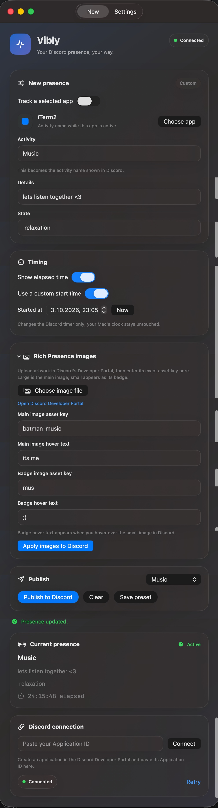

# Vibly

Vibly is a native macOS SwiftUI app for managing a Discord Rich Presence.

  

## Current status

Manual and automatic presence flows are in place:

- Manual presence form with activity, details, state, and elapsed timer.
- New tab with one shared presence editor.
- Optional app tracking uses the selected app as the Activity name while it is frontmost.
- Details, state, timer, images, presets, and publishing are shared by custom and app-tracking presence.
- Settings tab is reserved for future configuration.
- Built-in presets and locally persisted last-used values.
- Set/Clear actions with user-facing validation and errors.
- Main window plus a macOS menu-bar item.
- Dedicated `DiscordPresenceProviding` service boundary.

Discord integration uses the desktop client's local RPC/IPC socket. Enter a
Discord Application ID in the app, keep Discord running, and press Connect.
The service sends `SET_ACTIVITY` frames directly to Discord and maps the
activity, details, state, elapsed timestamp, main image, badge image, and each
image's independent hover text. Requests are serialized and acknowledgements
are matched to the request nonce.

For images, upload artwork under the same Discord application used in Vibly's
connection settings. Save the changes in the Developer Portal, then enter the
exact asset keys in Vibly. **Choose image file** only suggests a key; it does
not upload the image. The main image and badge each have optional hover text.
Use **Apply images to Discord** to publish image edits without restarting the
current timer. Vibly warns when Discord does not return a requested image or
hover text.

A custom timer start time changes the timestamp sent to Discord; it does not
change macOS's system clock.

## Run

Open `Vibly.xcodeproj` in Xcode and press **Command-R**. Keep Discord running,
enter your Discord Application ID, and click **Connect**.
